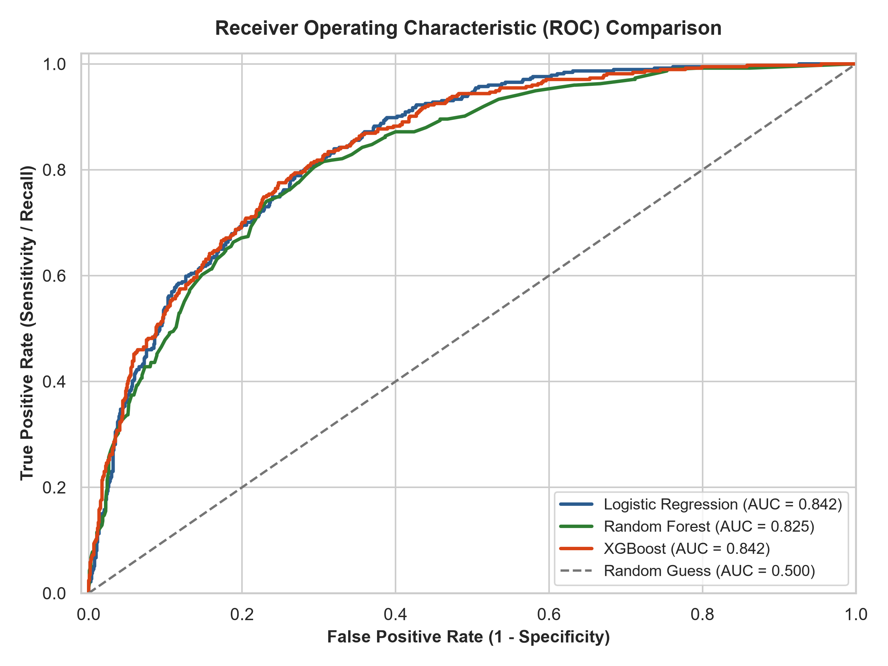
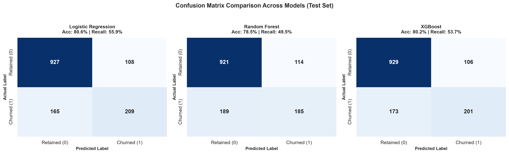
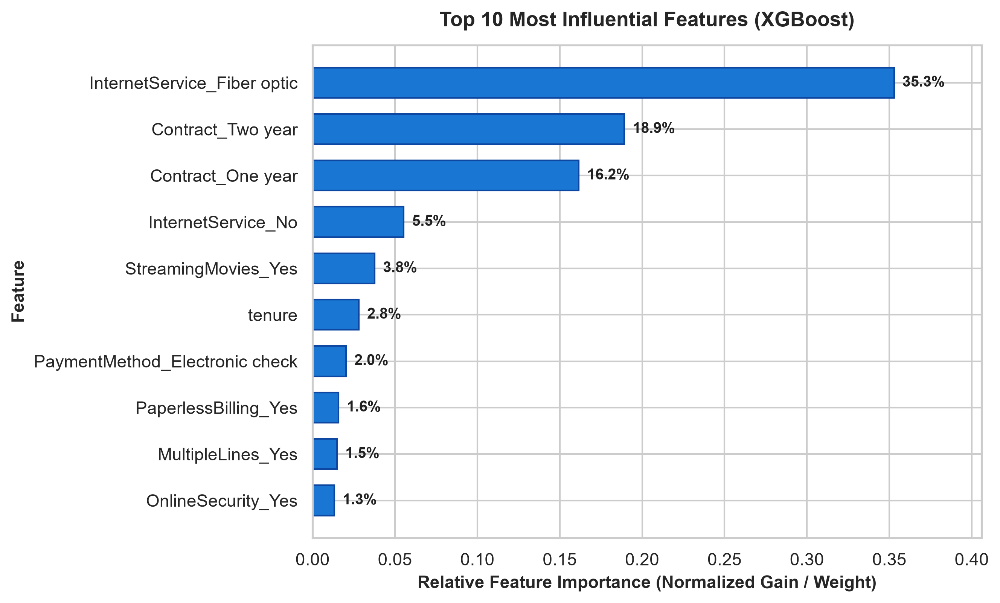

# 📊 Telecom Customer Churn Prediction Pipeline

[](https://www.python.org/)
[](https://scikit-learn.org/)
[](https://xgboost.readthedocs.io/)
[](LICENSE)
[]()

> A lightweight, end-to-end Machine Learning pipeline that identifies customers at risk of churn, analyzes key behavioral risk factors, and provides data-driven retention strategies using the Telco Customer Churn dataset.

---

## 📌 Executive Summary

Customer churn is a critical metric for telecommunication service providers, where customer acquisition costs significantly outpace retention expenses. This repository provides a clean, modular, and self-contained machine learning pipeline implemented in `churn_pipeline.py`. 

The pipeline automates:
1. **Data Ingestion & Cleaning**: Sanitizing unstructured charge fields, handling missing entries, and encoding binary targets.
2. **Leakage-Free Preprocessing**: One-hot encoding categorical variables, stratified train-test splitting (80/20), and feature scaling.
3. **Model Benchmarking**: Training and comparing three distinct algorithms — **Logistic Regression**, **Random Forest**, and **XGBoost**.
4. **Visual Analytics**: Generating publication-grade ROC curves, confusion matrices, and feature importance rankings.
5. **Actionable Business Intelligence**: Identifying key churn indicators (e.g., fiber optic service friction, month-to-month contracts) to guide proactive retention campaigns.

---

## 🏢 Business Problem & Dataset Overview

### The Problem
Telecom operators face steep revenue losses when subscribed users cancel services. Identifying early warning signals enables Customer Success and Marketing teams to launch targeted retention incentives before cancellation occurs.

### The Dataset
The pipeline utilizes `Telco-Customer-Churn.csv`, which captures customer demographics, account characteristics, and service subscriptions:
- **Total Samples**: 7,043 customers
- **Total Features**: 21 raw columns (demographics, contracted services, billing details)
- **Target Distribution**:
  - **Retained (`0`)**: 5,174 customers (~73.46%)
  - **Churned (`1`)**: 1,869 customers (~26.54%)
- **Class Balance**: Moderately imbalanced dataset, making **ROC-AUC** and **Recall** vital evaluation metrics alongside raw Accuracy.

---

## 🛠️ Pipeline Architecture & Methodology


### 1. Ingestion & Data Hygiene
- **Identifier Removal**: Dropped `customerID` to prevent arbitrary identifier bias.
- **Missing Value Handling**: In `TotalCharges`, 11 entries contained whitespace strings resulting from zero tenure accounts. These were parsed into numeric floats and zero-imputed.
- **Target Encoding**: Mapped target column `Churn` (`'Yes'` &rarr; `1`, `'No'` &rarr; `0`).

### 2. Feature Engineering & Preprocessing
- **Categorical Encoding**: Generated dummy variables via `pd.get_dummies(drop_first=True)` across 16 categorical fields, yielding 30 predictive features while avoiding the dummy variable trap.
- **Stratified Partitioning**: 80/20 train-test split (`random_state=42`) preserving class ratios across sets:
  - **Training Set**: 5,634 samples
  - **Test Set**: 1,409 samples
- **Feature Standardization**: Scaled continuous numerical features (`tenure`, `MonthlyCharges`, `TotalCharges`) using `StandardScaler` fitted strictly on the training set to prevent data leakage.

### 3. Model Suite
- **Logistic Regression**: Linear baseline with L2 penalty, scaled feature sensitivity, and probabilistic calibrations.
- **Random Forest Classifier**: Ensemble bagging model with 100 decision trees to capture non-linear feature interactions.
- **XGBoost Classifier**: Extreme Gradient Boosting optimized with log-loss objective function (includes automatic fallback to `GradientBoostingClassifier` if native XGBoost is absent).

---

## 📈 Model Benchmark & Evaluation

All models were evaluated on the unseen test set (1,409 samples). 

| Model | Accuracy | Precision | Recall | ROC-AUC | Primary Strength |
| :--- | :---: | :---: | :---: | :---: | :--- |
| **Logistic Regression** | **80.62%** | **65.93%** | **55.88%** | **84.22%** | Highest overall ROC-AUC and Recall |
| **XGBoost Classifier** | **80.20%** | **65.47%** | **53.74%** | **84.16%** | High non-linear discriminatory power |
| **Random Forest** | 78.50% | 61.87% | 49.47% | 82.48% | Balanced bagging baseline |

> **Key Observation**: Logistic Regression and XGBoost perform exceptionally close with **~84.2% ROC-AUC**. Logistic Regression achieves the highest recall on positive churners (55.88%), making it cost-effective for proactive retention intervention.

---

## 📊 Visual Analytics

The pipeline generates and exports high-resolution visual assets into the [`images/`](images/) directory:

### 1. ROC Curves
Comparison of True Positive Rate versus False Positive Rate across all classification thresholds:

<p align="center">
  
</p>

- Both **Logistic Regression** (AUC = 0.842) and **XGBoost** (AUC = 0.842) maintain a significant margin above random guessing (AUC = 0.500), displaying strong ranking capability across varying classification thresholds.

---

### 2. Confusion Matrices
Breakdown of True Negatives, False Positives, False Negatives, and True Positives on the test set:

<p align="center">
  
</p>

- **False Negatives Trade-off**: Logistic Regression missed only 165 churners compared to 189 for Random Forest and 173 for XGBoost. In subscription models, missed churners (False Negatives) are substantially more costly than outreach to non-churners (False Positives).

---

### 3. Feature Importance Analysis
Top 10 most influential predictors extracted from the best tree-based model (**XGBoost**):

<p align="center">
  
</p>

| Rank | Feature | Importance | Business Meaning |
| :---: | :--- | :---: | :--- |
| **#1** | `InternetService_Fiber optic` | **35.3%** | Fiber optic subscribers churn at markedly higher rates, pointing to potential service dissatisfaction, competitive alternatives, or pricing pressure. |
| **#2** | `Contract_Two year` | **18.9%** | Long-term contracts serve as the strongest protection against churn. |
| **#3** | `Contract_One year` | **16.2%** | Annual commitments drastically reduce churn likelihood compared to month-to-month plans. |
| **#4** | `InternetService_No` | **5.5%** | Customers with only basic telephone services exhibit low churn elasticity. |
| **#5** | `StreamingMovies_Yes` | **3.8%** | High-engagement multimedia users have distinct lifecycle dynamics. |
| **#6** | `tenure` | **2.8%** | Customer loyalty compounds over time; early tenure months carry the highest flight risk. |
| **#7** | `PaymentMethod_Electronic check` | **2.0%** | Payment friction and billing methods correlate strongly with churn. |

---

## 💡 Strategic Business Takeaways & Retention Playbook

Based on the empirical findings from model weights and tree importances:

1. **Address Fiber Optic Customer Experience**:
   - *Finding*: `InternetService_Fiber optic` is by far the single largest driver of churn (35.3% relative gain).
   - *Action*: Initiate technical quality-of-service audits on fiber connections and review pricing competitiveness against regional alternatives.

2. **Incentivize Contract Migration**:
   - *Finding*: Two-year and one-year contracts collectively account for over 35% of model importance. Month-to-month subscribers represent the largest pool of churners.
   - *Action*: Deploy automated promotional discounts (e.g., free upgrades or 10% monthly savings) targeted at month-to-month users approaching month 3 to lock in annual contracts.

3. **Critical First 90 Days (Tenure Onboarding)**:
   - *Finding*: Churn risk is concentrated in low-tenure accounts.
   - *Action*: Implement a dedicated onboarding check-in sequence within the first 30–90 days with technical support outreach and CSAT monitoring.

4. **Streamline Payment Methods**:
   - *Finding*: Electronic check users demonstrate higher attrition than auto-pay credit card and bank transfer subscribers.
   - *Action*: Offer a one-time bill credit ($5–$10) for switching payment methods to automated recurring credit card or bank transfer billing.

---

## 🚀 Reproduction & Setup Guide

### Prerequisites
- Python 3.10 or higher
- `pip` package manager

### Installation

```bash
# 1. Clone the repository
git clone https://github.com/<your-username>/customer-churn-prediction.git
cd customer-churn-prediction

# 2. (Optional) Create and activate a virtual environment
python -m venv .venv

# Windows:
.venv\Scripts\activate

# macOS / Linux:
source .venv/bin/activate

# 3. Install required dependencies
pip install -r requirements.txt

# 4. Run the end-to-end pipeline
python churn_pipeline.py
```

### Script Execution Output
Running `python churn_pipeline.py` executes all five pipeline phases, prints tabular benchmarks in the console, and updates the publication-grade plots in `images/`:

```text
======================================================================
STEP 1: DATA INGESTION & CLEANING
======================================================================
[+] Loaded raw dataset: 7043 rows, 21 columns
[+] Dropped 'customerID' identifier column.
[+] Converted 'TotalCharges' to numeric (filled 11 blank/NaN values with 0).
[+] Mapped target 'Churn': 'Yes' -> 1, 'No' -> 0

======================================================================
STEP 2: PREPROCESSING & FEATURE ENGINEERING
======================================================================
[+] Dataset shape after cleaning: 7043 rows x 20 columns
[+] Churn Class Distribution:
    - Retained (0):  5174 (73.46%)
    - Churned  (1):  1869 (26.54%)
[+] One-hot encoding applied: 30 feature columns generated.
[+] 80/20 Stratified train-test split:
    - Train set: 5634 samples
    - Test set : 1409 samples
[+] Standardized continuous features ['tenure', 'MonthlyCharges', 'TotalCharges'] without leakage.

======================================================================
STEP 3: MODEL TRAINING
======================================================================
[*] Training Logistic Regression...
[*] Training Random Forest Classifier (n_estimators=100, random_state=42)...
[*] Training XGBoost Classifier (n_estimators=100, random_state=42)...

======================================================================
STEP 4: MODEL EVALUATION & COMPARISON
======================================================================
--------------------------------------------------------------
Model                        | Accuracy  | Precision | Recall  | ROC-AUC 
--------------------------------------------------------------
Logistic Regression          | 80.62%    | 65.93%    | 55.88%  | 84.22%  
Random Forest                | 78.50%    | 61.87%    | 49.47%  | 82.48%  
XGBoost                      | 80.20%    | 65.47%    | 53.74%  | 84.16%  
--------------------------------------------------------------

======================================================================
STEP 5: GENERATING VISUALIZATIONS
======================================================================
[+] Saved ROC curves: images/roc_curves.png
[+] Saved confusion matrices: images/confusion_matrices.png
[+] Saved feature importance plot: images/feature_importance.png
======================================================================
```

---

## 📁 Repository Structure

```text
customer-churn-prediction/
├── Telco-Customer-Churn.csv       # Raw Telco customer churn dataset
├── churn_pipeline.py              # End-to-end Python pipeline script
├── requirements.txt               # Minimal stable project dependencies
├── .gitignore                     # Git ignore rules for clean repository
├── README.md                      # Comprehensive project documentation
└── images/                        # Generated publication-quality figures
    ├── roc_curves.png             # Overlayed ROC curves & AUC benchmark
    ├── confusion_matrices.png     # Side-by-side test confusion matrices
    └── feature_importance.png     # Top 10 feature importance bar chart
```

---

## 📜 License

This project is licensed under the [MIT License](LICENSE) — free for academic, portfolio, and commercial use.
